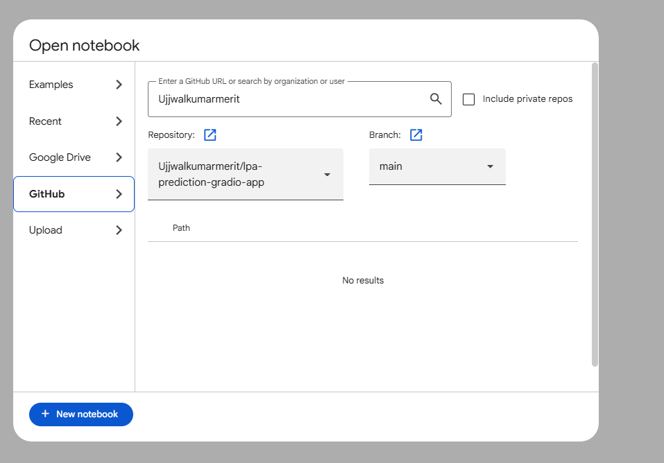

# 🎓 Student Placement LPA Predictor

[](https://colab.research.google.com/github/Ujjwalkumarmerit/lpa-prediction-gradio-app/blob/main/LPA_Prediction_Gradio_App.ipynb)
[](https://github.com/Ujjwalkumarmerit/lpa-prediction-gradio-app/blob/main/LICENSE)
[](https://github.com/gradio/gradio)


## 📱 Application Preview


An elegant, interactive web application built with **Gradio** that leverages a **Custom 2-Layer Neural Network** trained from scratch using NumPy to predict student placement packages (LPA - Lakhs Per Annum) based on **CGPA** and **Profile Score**.

---

## 🚀 Live Demo & Direct Execution

### ⚡ Run Instantly in One Click!
You can run this entire application directly in your browser without setting up anything on your local computer:

👉 **[Click Here to Launch on Google Colab](https://colab.research.google.com/github/Ujjwalkumarmerit/lpa-prediction-gradio-app/blob/main/LPA_Prediction_Gradio_App.ipynb)**

Once the Colab page opens, select **Runtime > Run All** from the top menu, scroll to the bottom, and interact with the live application link!

---

## 🚀 Project Overview

This project demonstrates how a feedforward neural network can be built, trained, and optimized manually using Python's numerical libraries without high-level deep learning frameworks like TensorFlow or PyTorch. To make the trained network accessible, an intuitive web interface is provided using **Gradio**.

### Key Features
* **Mathematical Foundations**: Forward propagation and backpropagation constructed completely from scratch using NumPy.
* **Interactive Interface**: Predict placement packages dynamically by adjusting sliders/inputs for CGPA and Profile Score.
* **Fast & Lightweight**: Negligible latency with minimum external dependencies.

---

## 🧠 Model Architecture & Mathematics

Under the hood, the predictor uses a fully connected **Deep Neural Network** with a `[2, 2, 1]` layer structure:
* **Input Layer ($L_0$)**: 2 Features ($X_{cgpa}$, $X_{profile\_score}$)
* **Hidden Layer ($L_1$)**: 2 Neurons
* **Output Layer ($L_2$)**: 1 Linear output (Predicted Package in LPA)

### Mathematical Formulation

#### 1. Forward Propagation
At each layer $l$, we compute the pre-activation value $Z^{[l]}$:

$$Z^{[l]} = W^{[l]T} A^{[l-1]} + b^{[l]}$$

Where:
* $A^{[0]} = X$ (Inputs)
* $W^{[l]}$ and $b^{[l]}$ represent the weight and bias matrices of layer $l$.
* Since this is a regression model working on a small linear boundaries context, linear activations are passed forward.

#### 2. Loss Function & Backpropagation
The network is optimized using the Mean Squared Error (MSE) loss function for individual samples:

$$\mathcal{L}(y, \hat{y}) = (y - \hat{y})^2$$

Parameters are updated using Gradient Descent with custom-computed analytical gradients:
* **Weights $W^{[2]}$ & Bias $b^{[2]}$ Update (Output Layer)**:
  $$\Delta W_i^{[2]} = lpha \cdot 2(y - \hat{y}) \cdot A_i^{[1]}$$
  $$\Delta b^{[2]} = lpha \cdot 2(y - \hat{y})$$

* **Weights $W^{[1]}$ & Bias $b^{[1]}$ Update (Hidden Layer)**:
  $$\Delta W_{ji}^{[1]} = lpha \cdot 2(y - \hat{y}) \cdot W_i^{[2]} \cdot X_j$$
  $$\Delta b_j^{[1]} = lpha \cdot 2(y - \hat{y}) \cdot W_j^{[2]}$$

Where $lpha$ represents the learning rate (configured to `0.001`).

---

## 🛠️ Installation & Setup (Local Machine)

Follow these steps to clone the repository and run the interactive application locally:

### 1. Clone the repository
```bash
git clone https://github.com/Ujjwalkumarmerit/lpa-prediction-gradio-app.git
cd lpa-prediction-gradio-app
```

### 2. Install dependencies
Ensure you have python installed ($>=3.8$), then run:
```bash
pip install numpy gradio
```

### 3. Run the App
Launch the local development server:
```bash
python app.py
```

Open your web browser and navigate to `http://127.0.0.1:7860` to access the interface.

---

## 📊 Sample Training Dataset

The model was iteratively trained on the following structural data mapping student stats to actual LPA outcomes:

| CGPA | Profile Score | Package (LPA) |
|---|---|---|
| 8.0 | 8.0 | 4.0 |
| 7.0 | 9.0 | 5.0 |
| 6.0 | 10.0 | 6.0 |
| 5.0 | 12.0 | 7.0 |

---

## 🤝 Contributing
Contributions, issues, and feature requests are welcome! Feel free to check the [issues page](https://github.com/Ujjwalkumarmerit/lpa-prediction-gradio-app/issues).

---

Developed with ❤️ by [Ujjwalkumarmerit](https://github.com/Ujjwalkumarmerit)
